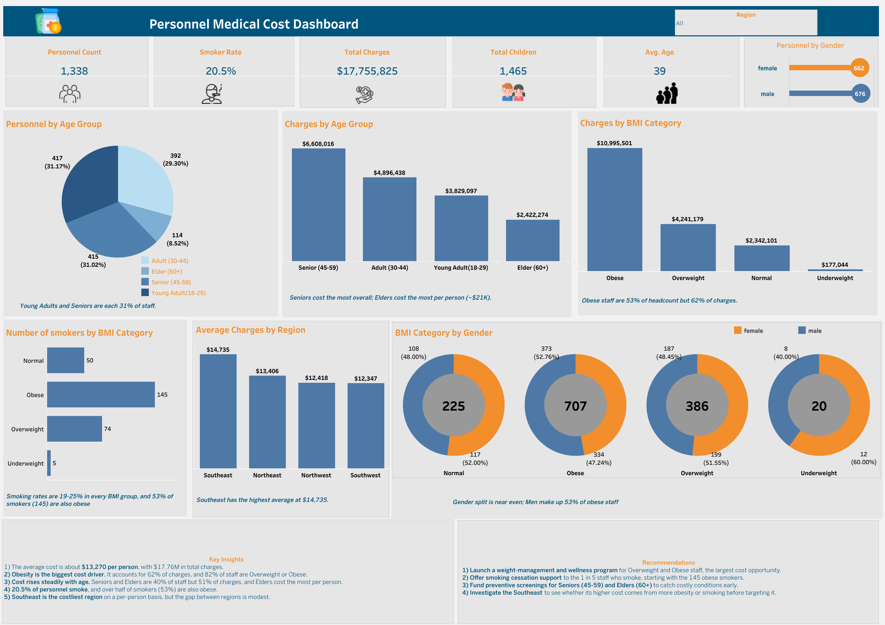

# Personnel Medical Cost Dashboard

An interactive **Tableau** dashboard analysing the medical insurance charges of 1,338 personnel, to find out what drives healthcare costs: age, BMI, smoking, gender or region.

🔗 **[View the live interactive dashboard on Tableau Public](https://public.tableau.com/views/PersonalMedicalCostonInsuranceAnalysis/PersonnelMedicalCostDashboard)**

---

## 📌 Project Overview

Medical insurance totalled **$17.76M** for 1,338 personnel, about **$13,270 per person**. To control these costs, an organisation needs to know where the money goes. This dashboard asks:

1. Which **age groups** and **BMI categories** drive the most charges?
2. How common is **smoking**, and how does it overlap with obesity?
3. Do costs differ by **gender** or **region**?
4. Where should wellness spending be **targeted** for the biggest impact?

## 🛠️ Tools & Skills

| Tool | Used for |
|---|---|
| **Tableau Public** | Dashboard design, KPI tiles, pie, bar and donut charts |
| **Calculated fields** | Age groups, BMI categories, smoker rate, smoker count, average charges |
| **Interactivity** | Region filter applied across the whole dashboard |
| **Storytelling** | An insight caption under every chart, plus insights and recommendations panels |

## 🔢 Key Metrics

| Metric | Value |
|---|---|
| Personnel | **1,338** (662 female, 676 male) |
| Total Charges | **$17,755,825** |
| Average Charge per Person | **~$13,270** |
| Smoker Rate | **20.5%** (274 smokers) |
| Average Age | **39** |
| Total Children (dependants) | **1,465** |

## 💡 Key Insights

- **Obesity is the biggest cost driver.** Obese staff are 53% of headcount but account for **62% of charges ($11.0M)**, and **82%** of staff are overweight or obese.
- **Costs rise steadily with age.** Seniors (45–59) and Elders (60+) are 40% of staff but **51% of charges**. Seniors cost the most overall ($6.6M), while Elders cost the most **per person (~$21K)**.
- **1 in 5 staff smoke.** Smoking rates sit between 19% and 25% in every BMI group, and **53% of smokers (145) are also obese**, a high-risk overlap.
- **Region matters, but less.** The Southeast has the highest average charge ($14,735), only about $2,400 above the lowest region (Southwest, $12,347).
- **Gender is close to even.** Men make up slightly more of the obese group (53%).

## ✅ Recommendations

1. **Launch a weight-management and wellness programme** for overweight and obese staff, the largest cost opportunity.
2. **Offer smoking cessation support** to the 1 in 5 staff who smoke, starting with the 145 obese smokers.
3. **Fund preventive screenings** for Seniors (45–59) and Elders (60+) to catch costly conditions early.
4. **Investigate the Southeast** to see whether its higher costs come from more obesity or smoking before targeting it.

## 📚 Data Source

[Medical Cost Personal Dataset](https://www.kaggle.com/datasets/mirichoi0218/insurance) (Kaggle): 1,338 records with age, sex, BMI, children, smoker status, region and insurance charges.

## 📁 Repository Contents

| File | Description |
|---|---|
| `personnel-medical-cost-dashboard.png` | Full dashboard screenshot |
| `Personnel-Medical-Cost-Dashboard.pdf` | Dashboard exported as PDF |

🔗 Live dashboard: [Tableau Public](https://public.tableau.com/views/PersonalMedicalCostonInsuranceAnalysis/PersonnelMedicalCostDashboard)

---

## 👩🏾‍💻 Author

**Aghogho (Faith) Awaritoma**, Data Analyst · Power BI · Tableau · Excel · SQL · Looker Studio

🔗 [LinkedIn](https://www.linkedin.com/in/awaritomafaith) · [GitHub](https://github.com/Aghogho-data)
